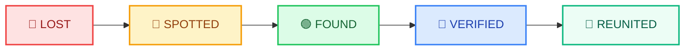

# 🔎 Lost & Found Hub

<div align="center">

> **"Don't just report what's missing. Help it find its way home."**

[](https://lost-and-found-hub-zeta.vercel.app)
[](https://github.com/Pradeepkumar0018/lost-and-found-hub)
[](https://react.dev/)
[](https://vitejs.dev/)
[](https://tailwindcss.com/)
[](LICENSE)

### 🌐 **Live Web Application**: [https://lost-and-found-hub-zeta.vercel.app](https://lost-and-found-hub-zeta.vercel.app)

</div>

---

## 📖 Table of Contents

- [Overview](#-overview)
- [The Missing Trail Lifecycle](#-the-missing-trail-lifecycle)
- [Key Features](#-key-features)
- [Architecture & Tech Stack](#-architecture--tech-stack)
- [Directory Structure](#-directory-structure)
- [Route Index](#-route-index)
- [Demo Credentials](#-demo-credentials)
- [Getting Started Locally](#-getting-started-locally)
- [Deployment & Configuration](#-deployment--configuration)
- [Contributing & License](#-contributing--license)

---

## 🌟 Overview

**Lost & Found Hub** is not a basic CRUD listing website. It is a **community-powered recovery network** designed to turn passive reporting into active, collaborative item recovery. 

Built with **React**, **Vite**, **Tailwind CSS**, and modern web best practices, it provides end-to-end tracing for lost items through real-time community sightings, an algorithmic matching engine, private ownership verification, and safe public handover coordination.

---

## ⭐ The Missing Trail Lifecycle

The central pillar of Lost & Found Hub is the **Missing Trail**. Every item has an interactive, timestamped timeline tracing its complete recovery journey:

### Standard Items Lifecycle:

```mermaid
flowchart LR
    A[🔴 LOST] --> B[🟡 SPOTTED]
    B --> C[🟢 FOUND]
    C --> D[✨ MATCHED]
    D --> E[🔐 VERIFIED]
    E --> F[🤝 HANDOVER]
    F --> G[🔵 RETURNED]
    
    style A fill:#fee2e2,stroke:#ef4444,stroke-width:2px,color:#991b1b
    style B fill:#fef3c7,stroke:#f59e0b,stroke-width:2px,color:#92400e
    style C fill:#dcfce7,stroke:#22c55e,stroke-width:2px,color:#166534
    style D fill:#ede9fe,stroke:#8b5cf6,stroke-width:2px,color:#5b21b6
    style E fill:#dbeafe,stroke:#3b82f6,stroke-width:2px,color:#1e40af
    style F fill:#ffedd5,stroke:#f97316,stroke-width:2px,color:#9a3412
    style G fill:#ccfbf1,stroke:#14b8a6,stroke-width:2px,color:#115e59
```


### Pet Recovery Lifecycle:


---

## 🎯 Key Features

### 1. 📍 Interactive Missing Trails (`/trail/:id`)
- Visual chronological progression through milestones (Lost, Spotted, Found, Matched, Verified, Handover, Returned).
- Interactive event cards showing exact time, geographic location, submitter info, and attached notes/photos.
- Live status tracker with pulse indicators and progress bars.

### 2. 📝 Guided 7-Step Multi-Stage Reporting Wizards
- **Step 1: Category Selection** (Phones, Documents, Bags, Pets, Electronics, Keys, Wallets, Accessories, Other).
- **Step 2: Item Details** (Name, Brand, Model, Color, Description, Image Upload with local instant preview).
- **Step 3: Location Mapping** (Area, City, landmark selector, and visual coordinates picker).
- **Step 4: Date & Time** (Exact timestamp selector).
- **Step 5: Private Verification Detail** (Private detail only the genuine owner knows; never displayed publicly).
- **Step 6: Contact Information** (Preferred contact method and privacy controls).
- **Step 7: Review & Instant Submission**.

### 3. 👀 Community Sightings ("I Saw This")
- Neighbors, commuters, and bystanders can log sightings without taking custody of an item.
- Upload sighting location, notes, and photos.
- Each sighting immediately attaches a 🟡 **SPOTTED** pin to the item's Missing Trail.

### 4. 🤖 Algorithmic Smart Matching Engine (`matchingAlgorithm.js`)
- Automated cross-referencing between all open **Lost** and **Found** reports.
- Comprehensive confidence score breakdown:
  - **Category Match:** 30% weighting
  - **Name & Brand Similarity:** 35% weighting
  - **Geographic Proximity:** 20% weighting
  - **Timeline Proximity:** 15% weighting
- Displays candidate match cards with direct side-by-side comparison.

### 5. 🔐 Zero-Knowledge Ownership Verification
- Prevents fraudulent claims: claimants must correctly answer the reporter's secret question (e.g., *"What is written on the back of the phone case?"* or *"What is the engraved initials inside the ring?"*).
- System checks answer fuzzy-matching to confirm legitimate ownership before releasing contact details.

### 6. 🤝 Safe Public Handover Coordination
- Built-in safe meetup messenger for verified claimants and finders.
- Pre-populated public safety guidelines (meet in daylight, police stations, public transit hubs).
- Dual-party completion handshake: marks the item officially **RETURNED** / **REUNITED**.

### 7. 🐾 Dedicated Pet Recovery Hub (`/pets`)
- Tailored fields: Breed, Species, Age, Gender, Collar/Tag info, Microchip status.
- Urgent emergency badge toggles for quick community mobilization.
- Concludes with the celebratory 🐾 **REUNITED** status.

### 8. 🔎 Mystery Items Crowd-Sourcing (`/mystery-items`)
- Dedicated portal for unidentified, rare, or cryptic discovered objects.
- Community guessing, discussions, and upvoting to help finders identify mystery belongings.

### 9. 🛡️ Comprehensive Admin & Moderation Console (`/admin`)
- Platform-wide statistics and activity monitoring.
- Report moderation queue (Approve, Flag, Suspend, Edit).
- User management and community safety enforcement.

### 10. 🎨 UI/UX Excellence & Accessibility
- **Full Dark & Light Mode** with persistent preference detection.
- **Responsive design** optimized for smartphones, tablets, and wide desktop displays.
- **Glassmorphism cards**, subtle transitions, accessible contrast ratios, and complete empty states.
- **Local persistence** via LocalStorage seeded with 22+ realistic real-world reports.

---

## 🛠️ Architecture & Tech Stack

```text
               ┌────────────────────────────────────────────────────────┐
               │                   LOST & FOUND HUB                     │
               └───────────────────────────┬────────────────────────────┘
                                           │
         ┌─────────────────────────────────┼────────────────────────────────┐
         ▼                                 ▼                                ▼
┌─────────────────┐             ┌────────────────────┐            ┌───────────────────┐
│ Presentation    │             │ State & Logic      │            │ Data & Engine     │
├─────────────────┤             ├────────────────────┤            ├───────────────────┤
│ • React 18      │             │ • Context API      │            │ • LocalStorage    │
│ • Tailwind CSS  │             │   - AuthContext    │            │ • Matching Engine │
│ • Lucide React  │             │   - LostFoundCtx   │            │ • 22+ Mock Data   │
│ • React Router  │             │   - NotifContext   │            │ • Validations     │
│ • Glassmorphism │             │   - ThemeContext   │            │ • Date Formatters │
└─────────────────┘             └────────────────────┘            └───────────────────┘
```

| Technology | Purpose |
| :--- | :--- |
| **[React 18.3](https://react.dev/)** | Component-driven declarative UI architecture |
| **[Vite 5.4](https://vitejs.dev/)** | Lightning-fast build tooling and HMR dev server |
| **[Tailwind CSS 3.4](https://tailwindcss.com/)** | Utility-first responsive design system with dark mode |
| **[React Router DOM 6.26](https://reactrouter.com/)** | Client-side routing, protected routes, and dynamic parameters |
| **[Lucide React](https://lucide.dev/)** | Lightweight, consistent iconography across all modules |
| **[Context API](https://react.dev/reference/react/useContext)** | Global state management for authentication, reports, and UI state |
| **[Vercel Platform](https://vercel.com/)** | Serverless Edge CDN hosting with instant SPA rewrites |

---

## 📂 Directory Structure

```text
lost-and-found-hub/
├── public/
│   └── favicon.svg               # Application Brand Favicon
├── src/
│   ├── assets/                   # Static assets & graphics
│   ├── components/
│   │   ├── common/               # Button, Badge, Modal, Card, Toast, ThemeToggle, EmptyState, etc.
│   │   ├── dashboard/            # StatsOverview, ReputationBadge
│   │   ├── forms/                # Multi-step wizards (Lost & Found), SightingModal, ClaimModal, etc.
│   │   ├── layout/               # Navbar (Responsive + Mobile Menu), Footer
│   │   ├── notifications/        # NotificationItem & Activity Feed
│   │   ├── reports/              # ItemCard, FilterPanel, SearchBar, MapVisualizer, MysteryCard
│   │   └── trail/                # TrailTimeline, TrailEvent, TrailStatusTracker
│   ├── constants/
│   │   ├── categories.js         # Category metadata, icons, and IDs
│   │   ├── statuses.js           # Status themes, badges, and lifecycle transitions
│   │   └── badges.js             # User reputation badges & achievement levels
│   ├── context/
│   │   ├── AuthContext.jsx       # Authentication state, demo users, profile
│   │   ├── LostFoundContext.jsx  # Primary state (CRUD, sightings, verification, matches)
│   │   ├── NotificationContext.jsx # Real-time in-app alerts and notifications
│   │   └── ThemeContext.jsx      # Light / Dark theme persistence
│   ├── data/
│   │   └── initialMockData.js    # 22+ comprehensive, realistic seed reports
│   ├── pages/
│   │   ├── Home.jsx              # Landing page (Hero, Categories, Recent, How It Works, Stats)
│   │   ├── Explore.jsx           # Filterable search engine with Grid, List & Map view modes
│   │   ├── ReportLost.jsx        # 7-step Lost Item wizard
│   │   ├── ReportFound.jsx       # 7-step Found Item wizard
│   │   ├── ItemDetail.jsx        # Detail view with embedded trail, verification, and chat
│   │   ├── MissingTrailPage.jsx  # Dedicated trail view wrapper
│   │   ├── Pets.jsx              # Dedicated Pet recovery hub
│   │   ├── MysteryItems.jsx      # Crowd-sourced mystery items portal
│   │   ├── Dashboard.jsx         # User overview, reputation scores, active trails
│   │   ├── MyReports.jsx         # User report management console
│   │   ├── NotificationsPage.jsx # Full-screen notification inbox
│   │   ├── AdminDashboard.jsx    # Moderation console, user manager, stats
│   │   ├── Login.jsx             # One-click quick login & manual sign-in
│   │   ├── Register.jsx          # New user onboarding
│   │   ├── About.jsx             # Platform mission & community guidelines
│   │   ├── HowItWorks.jsx        # Visual step-by-step recovery guide
│   │   └── NotFound.jsx          # 404 page with recovery navigation
│   ├── utils/
│   │   ├── matchingAlgorithm.js  # Multi-factor confidence matching logic
│   │   ├── storage.js            # Safe LocalStorage wrapper
│   │   ├── dateFormatter.js      # Humanized relative & absolute timestamps
│   │   └── validators.js         # Form field & secret question validators
│   ├── App.jsx                   # Route declarations and layout shells
│   ├── index.css                 # Custom Tailwind base styles and theme tokens
│   └── main.jsx                  # Application entry point
├── vercel.json                   # SPA routing rewrites for Vercel
├── vite.config.js                # Vite build and dev server configuration
├── tailwind.config.js            # Tailwind typography, theme extensions & colors
└── package.json                  # Dependencies and build scripts
```

---

## 🧭 Route Index

| Route | Protected? | Description |
| :--- | :---: | :--- |
| **`/`** | ❌ | Landing page with Hero search, stats counter, category showcase, and community CTA |
| **`/explore`** | ❌ | Multi-filter search engine (Grid, List, and Map Visualizer modes) |
| **`/item/:id`** | ❌ | Item details, timeline, sighting submissions, claim initiation |
| **`/trail/:id`** | ❌ | Dedicated Missing Trail view tracking the item's journey |
| **`/report-lost`** | ❌ | 7-Step guided wizard for reporting a lost item with private verification |
| **`/report-found`** | ❌ | 7-Step guided wizard for reporting a discovered item |
| **`/pets`** | ❌ | Specialized Pet Recovery hub with emergency filters & animal profiles |
| **`/mystery-items`** | ❌ | Mystery items portal with community guessing and upvoting |
| **`/how-it-works`** | ❌ | Interactive walkthrough of the 7 recovery phases |
| **`/about`** | ❌ | Mission statement, community safety rules, and platform philosophy |
| **`/login`** | ❌ | Authentication page with one-click demo logins |
| **`/register`** | ❌ | User registration with auto-login |
| **`/dashboard`** | 🔒 | Personal recovery dashboard, reputation badges, and stats |
| **`/my-reports`** | 🔒 | Complete user reports manager (Edit, Close, Delete, View Trail) |
| **`/notifications`**| 🔒 | In-app alerts for match candidates, sightings, and claim updates |
| **`/admin`** | 🔒 *(Admin only)* | Moderation portal with report inspection and user management |
| **`*`** | ❌ | Custom 404 error page with quick recovery navigation |

---

## 🔑 Demo Credentials

To experience the full capabilities of Lost & Found Hub, click any of the **One-Click Quick Login** buttons on the [`/login`](https://lost-and-found-hub-zeta.vercel.app/login) page, or use:

| Role | Email | Password | Access Privileges |
| :--- | :--- | :--- | :--- |
| **Community User** | `rohan.sharma@example.com` | `demo123` | Dashboard, My Reports, Sighting Submissions, Ownership Verification, Handover Messenger |
| **Platform Admin** | `admin@lafhub.org` | `admin123` | Full Access + `/admin` Moderation Console, Flag Management, Report Editing/Removal |

---

## 💻 Getting Started Locally

### Prerequisites
- [Node.js](https://nodejs.org/) (version 18.0 or newer)
- npm (version 9.0 or newer) or pnpm / yarn

### Installation Steps

1. **Clone the repository:**
   ```bash
   git clone https://github.com/Pradeepkumar0018/lost-and-found-hub.git
   cd lost-and-found-hub
   ```

2. **Install project dependencies:**
   ```bash
   npm install
   ```

3. **Start the local development server:**
   ```bash
   npm run dev
   ```
   Open [http://localhost:3000](http://localhost:3000) in your browser.

4. **Build for production:**
   ```bash
   npm run build
   ```
   The production-optimized bundle will be emitted to `dist/`.

5. **Preview the production build locally:**
   ```bash
   npm run preview
   ```

---

## 🚀 Deployment & Configuration

### Vercel Deployment
The repository includes a pre-configured `vercel.json` to handle Single Page Application (SPA) client-side routing rewrites:

```json
{
  "rewrites": [
    {
      "source": "/(.*)",
      "destination": "/index.html"
    }
  ]
}
```

The application is deployed at:
- **Production URL:** [https://lost-and-found-hub-zeta.vercel.app](https://lost-and-found-hub-zeta.vercel.app)
- **Deployment Team Alias:** [https://lost-and-found-hub-pradeep-kumars-projects-af1ef821.vercel.app](https://lost-and-found-hub-pradeep-kumars-projects-af1ef821.vercel.app)

Every push to branch `main` on GitHub triggers an automated production deployment on Vercel.

---

## 🤝 Contributing & License

Contributions, issues, and feature requests are welcome! Feel free to check the [issues page](https://github.com/Pradeepkumar0018/lost-and-found-hub/issues).

Distributed under the **MIT License**. See `LICENSE` for more information.

<div align="center">

Built with ❤️ for communities everywhere.

**[⬆ Back to Top](#-lost--found-hub)**

</div>
